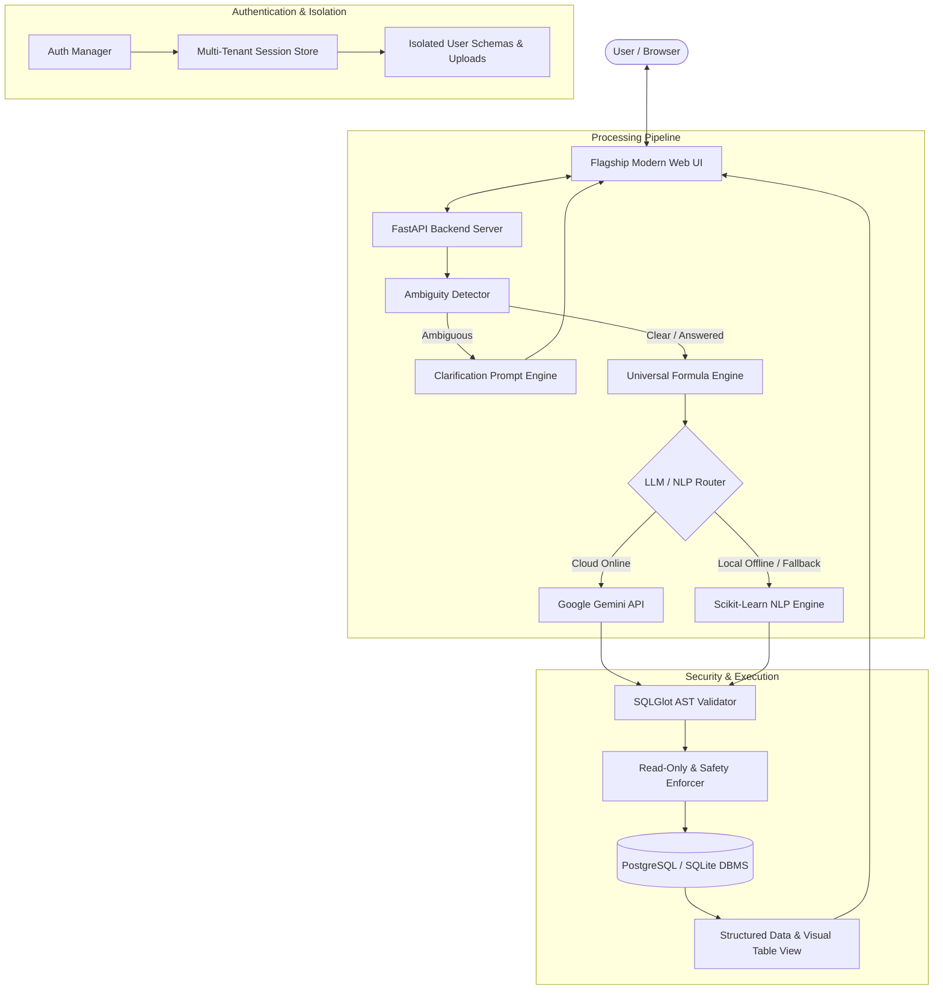

# 🧠 Text-to-SQL with Clarification Engine

[](https://fastapi.tiangolo.com)
[](https://www.python.org)
[](https://www.postgresql.org)
[](https://ai.google.dev)
[-F7931E?style=flat&logo=scikit-learn&logoColor=white)](https://scikit-learn.org)
[](https://github.com/tobymao/sqlglot)

> An enterprise-grade, conversational Text-to-SQL system powered by **Interactive Ambiguity Detection**, **Universal Domain Formulas**, **AST-level Security Guardrails**, and **Multi-Tenant Data Isolation**.

---

## 📌 Overview

Traditional Text-to-SQL tools make dangerous assumptions when presented with ambiguous or underspecified queries. For example, asking *"Show me the top bowlers"* without specifying a metric could mean most wickets, best economy, or lowest bowling average.

The **Text-to-SQL with Clarification Engine** solves this fundamentally:
1. **Detects Ambiguities** before any SQL query is drafted.
2. **Engages the User** with concise, targeted multi-choice clarification questions.
3. **Applies Universal Domain Formulas** (Cricket/IPL analytics, financial metrics, physics & statistical equations).
4. **Validates SQL through AST Parsers** ensuring strict read-only execution, schema validation, and SQL-injection prevention.
5. **Operates in Hybrid Mode** — leveraging cloud LLMs (Google Gemini) with automatic fallback to a self-contained, 100% offline local Scikit-Learn NLP model.

---

## ✨ Key Features

### 1. 🔍 Intelligent Clarification & Ambiguity Engine
- **Multi-Category Ambiguity Detection**: Flags lexical ambiguity, ambiguous column/table mappings, underspecified aggregations, missing sorting directions, and temporal scope ambiguities.
- **Interactive Multi-Turn Dialogue**: Prompts users with structured multiple-choice clarification pills and remembers selections across session turns.
- **Anti-Greedy Schema Linking**: Filters noise and stopword tokens so conversational words don't hijack table and column resolution.

### 2. 🧮 Universal Domain Formula & Calculation Engine
Built-in domain intelligence capable of answering complex analytical calculations:
- 🏏 **Cricket & Sports Analytics**: Bowling strike rate, batting strike rate, bowling average, economy rate, boundary percentage, head-to-head match breakdowns (`CSK vs MI`), and toss statistics.
- 💼 **Finance & Business**: ROI, CAGR, Gross/Operating Margin, Net Present Value (NPV), Break-even point, EBITDA.
- 📐 **Mathematics & Statistics**: Standard Deviation, Variance, Pearson Correlation, Z-Score, Euclidean Distance, Exponential Growth.
- ⚙️ **Physics & Science**: Kinetic/Potential Energy, Force, Velocity/Acceleration, Ohm's Law, Gravitational Attraction, Work & Power.
- 🌍 **Geography & Conversions**: Haversine distance, speed/length/temperature unit conversions.

### 3. 🛡️ AST-Level SQL Validation & Security Guardrails
- **SQLGlot Abstract Syntax Tree (AST) Parsing**: Deep-inspects query structure before database handoff.
- **Strict Read-Only Enforcement**: Blocks mutating operations (`DROP`, `DELETE`, `TRUNCATE`, `UPDATE`, `ALTER`, `GRANT`, `INSERT`).
- **Injection & Exfiltration Defense**: Validates table/column existence against active schemas, disallows stacked queries, and injects default `LIMIT 500` pagination guards.

### 4. ⚡ Hybrid Dual-Provider Architecture
- **Gemini AI Provider**: High-reasoning cloud LLM using Google Gemini (`gemini-3.1-flash-lite`, `gemini-1.5-flash`).
- **Local Offline NLP Provider**: Embedded TF-IDF vectorizer + multiclass classifier trained on 197 domain seeds across 16 analytical intents with 100% classification accuracy.
- **Failover Guarantee**: Zero downtime — network dropouts automatically trigger local offline inference.

### 5. 👥 Flagship Multi-Tenancy & Workspace Isolation
- **Authentication**: Salted SHA-256 password hashing with bearer token session tracking.
- **Isolated User Datasets**: Each account maintains independent database schemas, uploaded files, and chat history.
- **First-Time User Experience**: Empty-state dashboards for fresh signups with sample data onboarding.

### 6. 📂 CSV / Excel Ingestion & Power BI Ready
- **Drag-and-Drop Ingestion**: Automatically creates tables, detects schema types, and indexes uploaded `.csv` and `.xlsx` files.
- **Power BI DAX Generator**: Pre-calculated DAX measure definitions and data dictionary guides for enterprise analytics.

---

## 🏛️ System Architecture



---

## 📁 Repository Structure

```text
├── backend/
│   ├── main.py                     # FastAPI application entrypoint & lifespan
│   ├── config.py                   # Pydantic environment configuration & settings
│   ├── database/
│   │   ├── connection.py           # Database connection manager (PostgreSQL / SQLite)
│   │   ├── schema_extractor.py     # Real-time schema inspection & linking
│   │   └── file_ingestion.py       # CSV and Excel file ingestion engine
│   ├── llm/
│   │   ├── base.py                 # Abstract LLM provider interface
│   │   ├── factory.py              # Provider factory with dynamic fallbacks
│   │   ├── gemini_provider.py      # Google Gemini integration
│   │   └── local_nlp_provider.py   # Offline Scikit-Learn NLP engine
│   ├── modules/
│   │   ├── ambiguity.py            # Ambiguity detection & multi-turn state
│   │   ├── clarification.py        # Question generator & option pills
│   │   ├── formula_engine.py       # Multi-domain calculation algorithms
│   │   ├── learning_engine.py      # Local ML training loop & seed datasets
│   │   ├── nlp_engine.py           # Offline rule-based SQL synthesis
│   │   ├── auth_manager.py         # Multi-tenant user auth & session management
│   │   └── conversation_manager.py # Conversation persistence & query tracking
│   └── routers/
│       ├── auth.py                 # Authentication API endpoints
│       ├── query.py                # Query, clarification, and execution routes
│       ├── database.py             # Schema inspection & table endpoints
│       └── files.py                # Dataset upload & management routes
├── data/
│   ├── models/                     # Trained local TF-IDF & classifier joblib binaries
├── frontend/
│   ├── index.html                  # Responsive modern web interface
│   ├── css/style.css               # Flagship dark/light theme styling
│   └── js/app.js                   # Client-side state, auth, and query controller
├── tests/                          # Comprehensive pytest test suite (27+ tests)
├── .env.example                    # Template environment configuration
├── .gitignore                      # Git exclusion rules for secrets and caches
├── requirements.txt                # Python package dependencies
├── SRS.md                          # Full Software Requirements Specification
└── README.md                       # Project documentation
```

---

## 🚀 Quick Start

### 1. Prerequisites
- **Python 3.10+**
- **Git**
- *(Optional)* PostgreSQL 14+ installed locally (SQLite is supported out-of-the-box for uploaded datasets).

### 2. Clone the Repository
```bash
git clone https://github.com/Raj-15042006/Text-To-SQL-with-Clarification-Engine.git
cd Text-To-SQL-with-Clarification-Engine
```

### 3. Create and Activate a Virtual Environment
```bash
# Windows (cmd / Git Bash)
python -m venv .venv
source .venv/Scripts/activate

# Linux / macOS
python3 -m venv .venv
source .venv/bin/activate
```

### 4. Install Dependencies
```bash
pip install -r requirements.txt
```

# Server Configuration
HOST=127.0.0.1
PORT=8000
```

### 6. Run the Application
```bash
python -m uvicorn backend.main:app --host 127.0.0.1 --port 8000 --reload
```

Open your browser and navigate to:
- **Web Interface**: [http://127.0.0.1:8000](http://127.0.0.1:8000)
- **Interactive OpenAPI Docs**: [http://127.0.0.1:8000/docs](http://127.0.0.1:8000/docs)

---

## 🧪 Running Tests

The test suite covers unit tests, multi-tenancy isolation, ambiguity resolution, domain formulas, and API endpoints:

```bash
# Run all tests
python -m pytest tests/ -v
```

---

## 💡 Example Queries & Interaction Flows

### 1. Ambiguity Clarification Flow
> **User**: *"Show me the top students."*  
> **Clarification Engine**: Detects missing metric and sorting criteria.  
> **Prompt**: *"Which metric would you like to rank students by?"*  
> **Options**: `[Highest Total Marks]`, `[Highest Percentage]`, `[By Specific Course]`  
> **User selects**: `[Highest Total Marks]`  
> **Generated SQL**:
> ```sql
> SELECT s.student_id, s.name, SUM(m.score) AS total_score
> FROM students s
> JOIN marks m ON s.student_id = m.student_id
> GROUP BY s.student_id, s.name
> ORDER BY total_score DESC
> LIMIT 10;
> ```

### 2. Domain Formula Query (Sports Analytics)
> **User**: *"Calculate the bowling strike rate of CSK throughout the season."*  
> **Formula Engine**: Applies $\text{Bowling Strike Rate} = \frac{\text{Balls Bowled}}{\text{Wickets Taken}}$ specifically filtered for CSK bowlers across all matches.

### 3. Business Financial Analytics
> **User**: *"Compute operating profit margin by region for Q3."*  
> **Generated SQL**:
> ```sql
> SELECT region, 
>        ROUND(((SUM(operating_income) / NULLIF(SUM(total_revenue), 0)) * 100)::numeric, 2) AS operating_margin_pct
> FROM enterprise_financials
> WHERE quarter = 'Q3'
> GROUP BY region
> ORDER BY operating_margin_pct DESC;
> ```

---

## 🔒 Security & Privacy

- **Zero Data Leakage**: `.env` and local database files are protected and ignored by `.gitignore`.
- **Injection Prevention**: Queries pass through SQLGlot AST validation; multi-statement attacks, comments, and injection vectors are discarded.
- **Permission Bounding**: Backend executes all user queries through a read-only database cursor with execution timeouts.

---

## 📜 License

This project is licensed under the **MIT License** — feel free to use, modify, and distribute.

